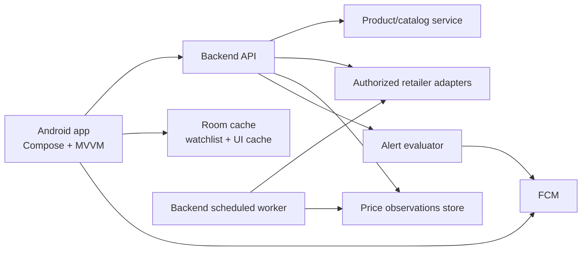

# Implementation Plan: PriceLens

## Overview

PriceLens is an India-first Android application for finding a product, comparing retailer prices from authorized sources, tracking only recorded price history, setting target-price alerts, and discovering alternatives. The first release should prove one end-to-end path: search a supported product, compare available retailer offers, inspect real recorded history, and create an alert.

Tasks are tracked as staged Multica child issues of `123-1`; only the foundation is ready to begin. Each later task remains parked until its dependencies and data-provider decision are satisfied.

## Confirmed Constraints

- Android client: Kotlin, Jetpack Compose, Material 3, MVVM, Coroutines/StateFlow, Hilt, Room, Retrofit/OkHttp, WorkManager, and FCM.
- Retailer pricing must come from permitted APIs, affiliate feeds, or authorized providers. No retailer scraping or bypassing access controls.
- Credentials stay in a backend or secure server-side environment, never in the APK.
- Product prices and price history must be truthful: unavailable is shown as unavailable, and historical charts appear only after observations have been recorded.
- Introducing a paid API/service requires Shadab's approval before it is added.

## Architecture

- **Android presentation:** feature-oriented Compose screens, ViewModels exposing immutable `StateFlow` UI state, and explicit loading/empty/error states. Liquid-glass treatment is limited to an accessible design system: readable contrast, reduced-motion support, and no blur-dependent content.
- **Domain:** product identity, retailer offer, price observation, watchlist/target alert, and alternative recommendation use cases. UI never interprets raw provider payloads.
- **Data:** repositories combine authenticated backend data with Room cache. Network DTOs are mapped at the data boundary; provider-specific schemas do not leak into UI/domain.
- **Backend:** a separate service owns retailer credentials, provider adapters, normalized catalog/offer APIs, persistent observations, alert evaluation, and FCM dispatch. Each adapter records source, timestamp, availability, currency, and a canonical product identity.
- **Trust and safety:** preserve source/timestamp per offer; never synthesize an unavailable price or fill a historical gap. Use Android Keystore-backed session storage, TLS, minimal analytics, server-side authorization, and rate limits.

## Delivery Order

1. **Foundation and design system** — Buildable Android baseline, clean feature/package boundaries, DI/navigation, themes, and a polished empty-state dashboard. This de-risks the stack and visual direction without claiming live data.
2. **Authorized data-source decision and comparison MVP** — Select and approve one legitimate provider, implement server-owned integration, and ship the search-to-comparison flow for products actually returned by that source.
3. **Truthful history and target alert vertical slice** — Record observations over time; present charts only when data exists; persist a watch target and evaluate/notify it from the backend.
4. **Product discovery expansion** — Add paste-URL ingestion where permitted, camera/OCR confirmation, alternatives/spec comparison, and account sync only after the core comparison flow is reliable.
5. **Production hardening** — accessibility, privacy/security review, observability, release automation, and staged rollout preparation.

## Task Index

| Order | Issue | Outcome | Dependency |
|---|---|---|---|
| 1 | Foundation Android app and design system | Buildable, testable Android shell with no fabricated commerce data | None |
| 2 | Approve and integrate one authorized pricing source | One working, compliant comparison path | 1; human provider decision |
| 3 | Real price observations and price-drop alerts | Truthful history and target alerts | 2 |
| 4 | Product discovery: URL, scan/OCR, alternatives | Expand input/discovery methods | 2 |
| 5 | Account sync and production readiness | Auth/sync plus operational release bar | 3, 4 |

## Checkpoints

- **After 1:** debug build and unit tests pass; light/dark empty states are verified on an emulator or device.
- **After 2:** a product returned by the approved source shows normalized offers, source/time, and unavailable retailers honestly.
- **After 3:** a recorded observation produces a chart/statistics; alert delivery is verified with a test target and notification.
- **Before release:** integration/UI tests pass, accessibility/security review is complete, privacy disclosures and support/runbook documentation are approved.

## Risks and Mitigations

| Risk | Impact | Mitigation |
|---|---|---|
| No approved retailer feed is available | Core value cannot be delivered | Treat provider selection as a gate; prototype only against provider-supported data and show unavailable explicitly. |
| Provider identity matching is inconsistent | Incorrect comparisons | Normalize canonical product IDs; require confidence/confirmation before grouping offers. |
| Sparse observations | Misleading chart | Store immutable timestamped observations and suppress history/statistics until enough real records exist. |
| Notifications are delayed or duplicated | Alert trust erodes | Make server-side evaluation idempotent and retain notification history. |
| Glass visual treatment harms accessibility | Reduced usability | Use it as decoration only; test contrast, font scaling, and reduced motion. |

## Open Approval Needed

Before Task 2 begins, Shadab must choose an authorized pricing/affiliate data source and explicitly approve it if it has cost, contractual commitments, or requires new credentials. The recommended initial scope is one approved source, not five retailers at once.
